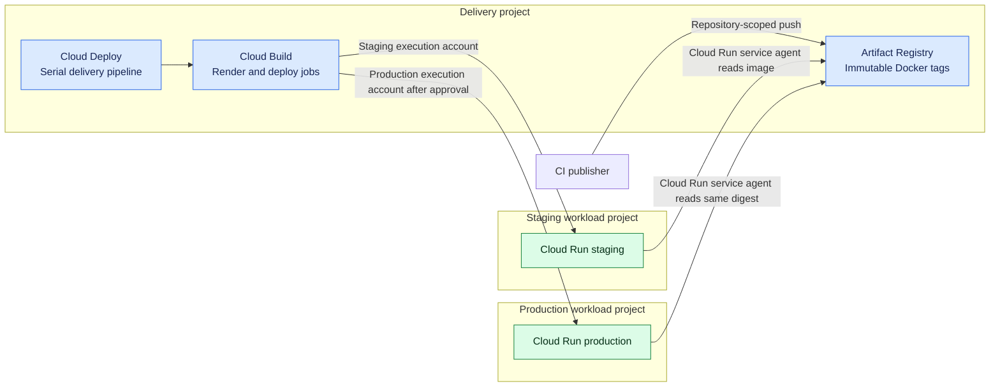
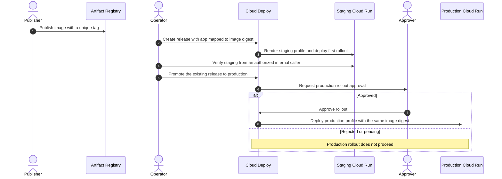
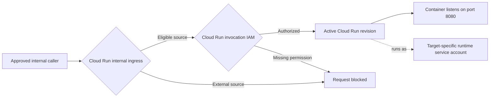
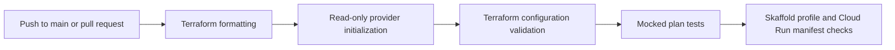
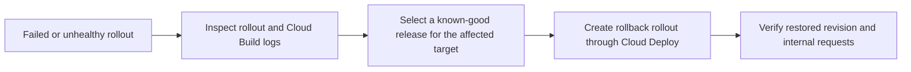

# GCP Release Foundation

**Promote one container image digest from staging to production with Terraform, Cloud Deploy, and Cloud Run.**

[](https://github.com/Pradyut6/gcp-release-foundation/actions/workflows/terraform.yml)

Terraform defines an immutable Artifact Registry, a two-stage delivery pipeline, and separate execution identities for two Cloud Run projects. Operators verify staging before requesting production promotion. Cloud Deploy holds the production rollout for approval.

[Architecture](#architecture) · [Release flow](#release-and-approval-flow) · [Traffic](#cloud-run-request-flow) · [Local verification](#run-locally) · [Google Cloud deployment](#deploy-to-google-cloud) · [Operations](#operations)

## Architecture

The delivery project owns the registry and the pipeline. Staging and production each have their own Cloud Run target, execution account, and runtime identity.



| Terraform manages | You supply |
| --- | --- |
| Docker repository with immutable tags | Delivery and workload projects with required APIs |
| Repository-scoped writer and reader IAM bindings | Publisher, execution accounts, and Cloud Run service agents |
| Ordered staging and production targets | Deployment permissions and dedicated Cloud Run runtime accounts |
| Production approval requirement | The release image, staging verification, and the authorized approver |

### Identity boundaries

| Identity | Purpose |
| --- | --- |
| Publisher | Pushes images using repository-scoped `roles/artifactregistry.writer`. |
| Staging and production Cloud Run service agents | Read the shared registry through repository-scoped `roles/artifactregistry.reader`. |
| Staging and production execution accounts | Run Cloud Deploy render and deploy jobs using the separately configured target permissions. |
| Cloud Run runtime accounts | Run application code in their respective workload projects. |
| Release creator and approver | Create or promote the release and authorize production rollout through Cloud Deploy IAM. |

[Registry and IAM](registry.tf) · [Pipeline and targets](pipeline.tf) · [Input validation](variables.tf)

## Release and approval flow



Skaffold selects the environment-specific manifest. The release binds the image placeholder `app` to a full Artifact Registry digest. Tags help identify builds, while the digest identifies the exact image promoted across environments. [Skaffold profiles](example-release/skaffold.yaml) · [Cloud Deploy for Cloud Run](https://cloud.google.com/deploy/docs/deploy-app-run)

## Cloud Run request flow



Both example services set internal ingress and send traffic to the latest revision. Validate from a source allowed by Cloud Run ingress and authenticate as an identity with invocation permission. The registry and deployment pipeline carry images and release configuration. Application requests go directly through Cloud Run. [Cloud Run ingress](https://cloud.google.com/run/docs/securing/ingress) · [Example service](example-release/service-staging.yaml)

## Run locally

Install Terraform **1.14.x** and run these commands from the repository root. The mocked plans need no Google Cloud credentials, and the provider lockfile records Linux and Windows AMD64 checksums.

```sh
terraform init -backend=false -input=false -lockfile=readonly
terraform fmt -check -recursive
terraform validate
terraform test
```

Run the example release checks with Ruby:

```sh
ruby scripts/check-release.rb example-release
```



The positive plan checks immutable tags, stage order, production approval, and registry IAM roles. The negative plan checks that staging and production cannot share a workload project. The example-release check validates profile order, internal ingress, distinct runtime accounts, and the replaceable image placeholder. [Workflow](.github/workflows/terraform.yml) · [Terraform tests](tests/release.tftest.hcl)

## Deploy to Google Cloud

1. **Prepare the projects.** Enable Artifact Registry, Cloud Deploy, and Cloud Build in the delivery project. Enable Cloud Run and initialize its service agent in each workload project.
2. **Prepare identities.** Give each execution account Cloud Deploy job-runner access in the delivery project and Cloud Run deployment permission in its target project. Grant access to act as the appropriate runtime service account, and configure the render, promotion, and approval permissions for the relevant identities. Consult the service-account guide for service-agent grants and artifact storage access. [Cloud Deploy service accounts](https://cloud.google.com/deploy/docs/cloud-deploy-service-account)
3. **Configure inputs.** Copy [terraform.tfvars.example](terraform.tfvars.example) to `terraform.tfvars` and replace every example value.
4. **Plan and apply.** Authenticate Terraform with Application Default Credentials. Review the plan before applying it. Use a restricted, versioned GCS backend before sharing Terraform state. The default local backend suits a disposable lab. Registry storage, build jobs, and Cloud Run workloads may incur charges.

```sh
gcloud auth application-default login
terraform init -lockfile=readonly
terraform plan -out=release.tfplan
terraform apply release.tfplan
terraform output -raw image_repository
```

### Create and promote a release

Set `DELIVERY_PROJECT`, `REGION`, and `PIPELINE` to your Terraform inputs. Choose a unique `RELEASE` name and set `IMAGE_DIGEST` to a published image reference ending in `@sha256:...`. The application must listen on port 8080. Replace the placeholder runtime accounts in [example-release](example-release) before submitting the release.

```sh
gcloud deploy releases create "$RELEASE" \
  --project="$DELIVERY_PROJECT" --region="$REGION" \
  --delivery-pipeline="$PIPELINE" --source=example-release \
  --images="app=$IMAGE_DIGEST"
```

Wait for the staging rollout to succeed. Verify application behavior from an authorized internal caller, then promote the same release.

```sh
gcloud deploy releases promote --release="$RELEASE" \
  --project="$DELIVERY_PROJECT" --region="$REGION" \
  --delivery-pipeline="$PIPELINE" --to-target="${PIPELINE}-production"
```

An authorized approver reviews the pending production rollout in Cloud Deploy before it proceeds. [Promotion and approvals](https://cloud.google.com/deploy/docs/promote-release)

## Operations

| Symptom | First check |
| --- | --- |
| Release fails to render | Confirm the source has both Skaffold profiles and the image mapping key is `app`. |
| Rollout fails to deploy | Inspect its Cloud Build logs and verify the execution account can deploy Cloud Run revisions and act as the runtime account. |
| Cloud Run cannot read the image | Check the exact digest and the workload project's Cloud Run service agent reader binding. |
| Staging cannot be reached | Check the caller's network source against internal ingress rules and verify invocation IAM. |
| Production is waiting | Inspect the production rollout and have an authorized approver review it. |

**Rollback.** Roll back the affected target through Cloud Deploy to a known-good release. Check the target’s approval status, then confirm the restored revision and application behavior. [Cloud Deploy rollback](https://cloud.google.com/deploy/docs/roll-back)



**Teardown.** Remove lab Cloud Run services separately. Retain any required release artifacts, review `terraform plan -destroy`, then destroy the delivery resources.

**Verification scope.** GitHub Actions and local tests verify Terraform and the release examples. A live Cloud Run rollout remains unverified.

## Attribution

Adapted from Google’s [Enterprise Application blueprint](https://github.com/GoogleCloudPlatform/terraform-google-enterprise-application). This implementation uses Cloud Run targets, an immutable registry, repository-scoped IAM, and a production approval gate. The original [Apache 2.0 license](LICENSE) is included.
